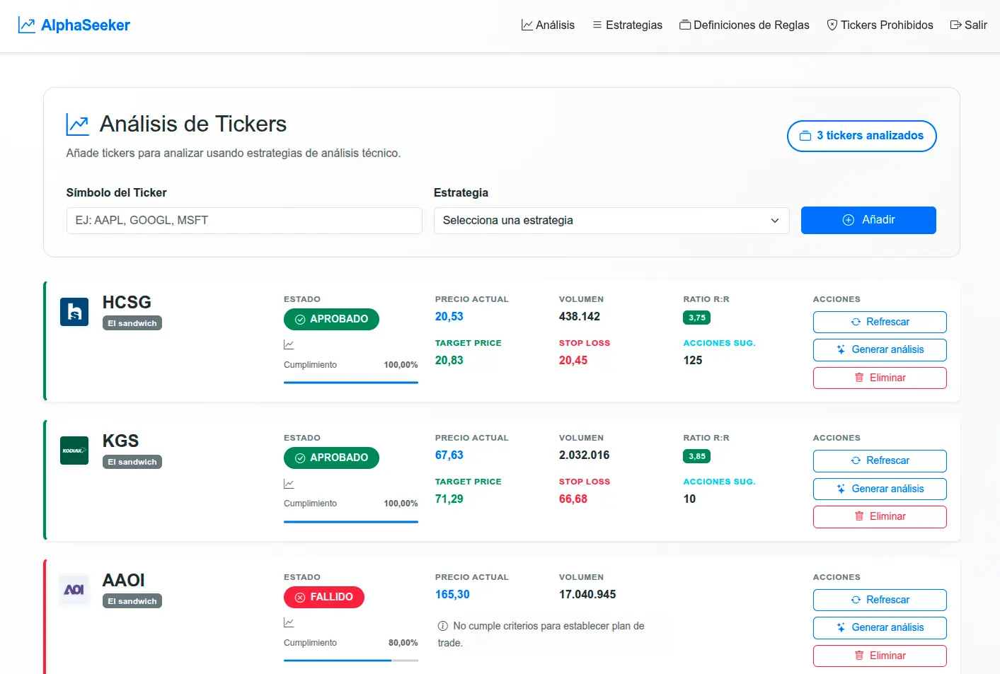
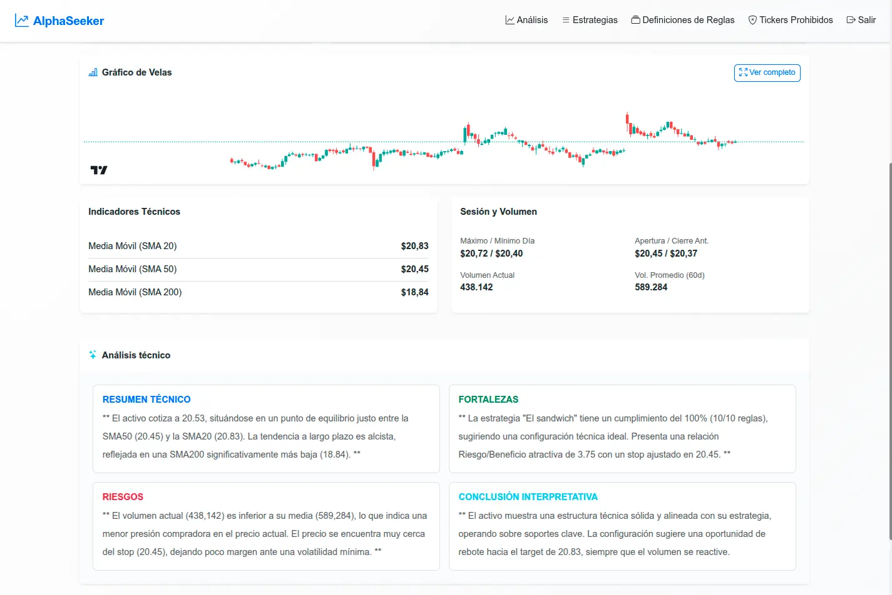

<!-- _class: lead -->
<!-- _backgroundColor: #0d6efd -->
<!-- _color: white -->
<!-- _footer: "" -->
<!-- _paginate: false -->

# Motor de Análisis Técnico de Acciones

## Evaluación determinista + IA solo interpretativa

**Rubén Touceda** · Máster Desarrollo con IA (Big School) · Octubre 2026

Proyecto real de uso personal: seleccionar acciones para el análisis fundamental.

---

# El problema

- Filtraba acciones en Finviz por parámetros, pero luego tocaba ir **una a
  una** clasificándolas como más o menos interesantes
- Ese triaje manual no escala: decenas de candidatas pidiendo **análisis
  fundamental** (históricos, beneficios, ganancias)
- Faltaba un **prefiltro cuantitativo**: que cada acción se evalúe sola con
  ratio riesgo/beneficio + entrada + stop-loss…
- …para quedarme solo con las mejores y dedicarles el análisis fundamental

---

# La idea: división clara

1. **Motor determinista**: reglas técnicas → score 0-100 + R:R + cumplimiento
2. **IA solo interpretativa**: redacta la síntesis desde métricas ya calculadas
3. **Uso de API externas**: Finviz, Polygon, Finnhub, OpenRouter todas sin coste

---

# ¿Cómo funciona?

El recorrido de una acción, de candidata a evaluada:

1. Ingesta de tickers o sugerencias automáticas (scrapper propio de Finviz) con filtro de seguridad
2. Enriquecimiento: OHLCV + SMA 20/50/200 y volumen (Polygon/Finnhub)
3. Evaluación declarativa: `Precio > SMA(50)` AND `Volumen > Media(20)`
4. Cálculo de R:R y score ponderado 0-100 por estrategia
5. Análisis IA a petición (async, con rotación de modelos ante 429)
6. Persistencia y seguimiento

---

# Motor de reglas + puntuación

- Cada **regla** es una condición simple ("el precio supera la media de
  50 días"): responde sí o no y lo justifica con números.
- Una **estrategia** exige varias reglas **a la vez**, cada una con su
  **peso**; superar la **nota mínima** da la puntuación (0-100).
- El **catálogo** lista cada indicador con su ficha: valores admitidos
  (la media acepta 20, 50 o 200 días), cálculo y usos permitidos.
- Guardián y auditoría: rechaza lo imposible antes de calcular y registra
  qué regla falló y por qué.

---

# Arquitectura hexagonal

De fuera adentro: Thymeleaf solo presenta; Application orquesta los casos de
uso; el Dominio (`Rule`, `Strategy`, `RuleEvaluator`) no depende de ningún
framework; Infrastructure adapta la base de datos, las APIs y la IA. Cambiar
de proveedor significa tocar un solo adaptador.

---

# Fronteras de la IA (diseño intencionado)

| Motor determinista | IA interpretativa |
|---|---|
| Evalúa reglas y métricas | Redacta síntesis desde métricas |
| Reproducible, testeable | No decide, no valida, no señaliza |
| 1165 tests lo cubren | Si falla → fallback + aviso |

Modelo principal `laguna-s-2.1` + 4 reservas · Planes gratuitos: latencias
altas **asumidas por diseño**, importa la corrección, no la velocidad.
Caso real: los 5 modelos fallaron con 429 y la evaluación siguió intacta
con aviso amistoso.

---

# Stack y calidad

- **Backend**: Java 21 · Spring Boot · JPA · WebClient · Thymeleaf + Bootstrap 5
- **Datos**: H2 (dev) · MariaDB (prod) · Finnhub / Polygon / Finviz / OpenRouter
- **Calidad**: 1165 tests, JaCoCo ≥80%, **SonarQube A** (63→0 issues), CI en PRs
- **Despliegue**: Docker + VPS propio con Nginx/SSL → <https://tfm.rubentouceda.es>
- Se evaluó Railway, pero la comunicación con la base de datos era lenta;
  el VPS además amplió conocimientos (endurecimiento, fail2ban, backups,
  red y certificados gestionados a mano)

---

# Desarrollo con IA: 2 fases + sello propio

1. **Copilot**: arranque y estructura con autocompletado, siempre supervisado
2. **OpenCode**: 1 rama = 1 tema = 1 doc = 1 PR, validación con menú
   (~40 PRs en el cierre, `docs/` con trazabilidad total)

En ambas fases hubo **desarrollo propio permanente**: se modificaban las
propuestas del agente, se hacían partes a mano y se resolvían imprevistos
y tuning.

Frontera sagrada: **la IA propone, la persona dispone**.

---

# La aplicación

 

En <https://tfm.rubentouceda.es> (usuario y contraseña de prueba en el
formulario de entrega): panel con estado APROBADO/FALLIDO, R:R y plan de
trade; detalle con velas, SMA y síntesis IA en 4 secciones (o aviso si falla).

---

# Limitaciones y futuro

**Hoy no hace**: recomendar inversión · operar · tiempo real · notificaciones
**Líneas futuras**:
- OpenAPI pública cuando haya API REST real
- Servicio ML separado (Python/FastAPI) desacoplado del motor
- Migración Spring Boot 4.x (fin del soporte OSS 3.5.x)

---

# Cierre: las 5 piezas

- ✅ README que se entiende sin abrir código
- ✅ Código supervisado en GitHub
- ✅ Despliegue productivo funcionando
- ✅ Estas slides versionadas
- ⬜ Formulario final con las URLs

**Gracias.**

