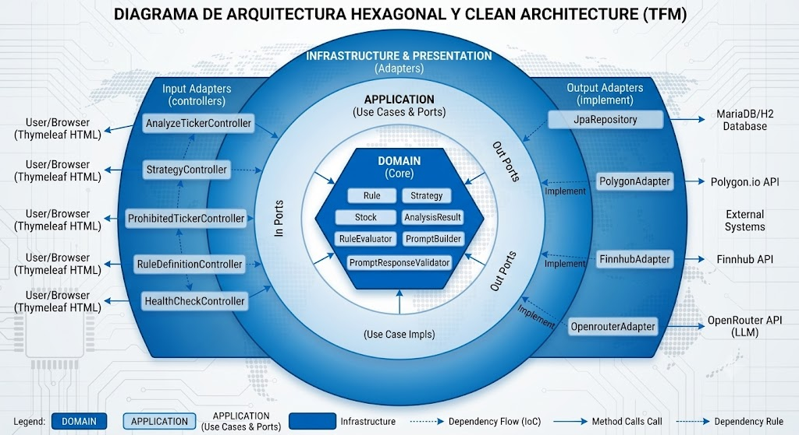

<!-- _class: lead -->
<!-- _backgroundColor: #0d6efd -->
<!-- _color: white -->
<!-- _footer: "" -->
<!-- _paginate: false -->

# AlphaSeeker - Motor de Análisis Técnico de Acciones

## Evaluación determinista + IA solo interpretativa

**Rubén Touceda** · Máster Desarrollo con IA (Big School) · Octubre 2026

Proyecto real de uso personal: seleccionar acciones para el análisis fundamental.

---

# El problema

- Filtraba acciones en Finviz por parámetros, pero luego tocaba ir **una a
  una** clasificándolas como más o menos interesantes
- Ese triaje manual no escala: decenas de candidatas pidiendo **análisis
  fundamental** (históricos, beneficios, ganancias...)
- Faltaba un **prefiltro cuantitativo**: que cada acción se evalúe sola con
  ratio riesgo/beneficio + entrada + stop-loss…
- …para quedarme solo con las mejores y dedicarles el análisis fundamental

---

# La idea: división clara

1. **Motor determinista**: reglas técnicas → score 0-100 + R:R + cumplimiento
2. **IA solo interpretativa**: redacta la síntesis desde métricas ya calculadas
3. **Uso de API externas**: Finviz, Polygon, Finnhub, OpenRouter. Todas sin coste aunque suponga limitar la velocidad de respuesta (planes gratuitos)

---

# ¿Cómo funciona?

El recorrido de una acción, de candidata a evaluada:

1. Ingesta de tickers o sugerencias automáticas (scrapper propio de Finviz async) con filtro de seguridad
2. Enriquecimiento: OHLCV + SMA 20/50/200 y volumen (Polygon/Finnhub)
3. Evaluación declarativa: Ej: `Precio > SMA(50)` AND `Volumen > Media(20)`
4. Cálculo de R:R y score ponderado 0-100 por estrategia
5. Análisis IA a petición (async, con rotación de modelos ante 429)
6. Persistencia y seguimiento

---

# Motor de reglas + puntuación

- Cada **regla** es una condición simple sobre el mercado, del tipo "el precio
  está por encima de la media de 50 días". Responde sí o no, y explica por
  qué enseñando los números.
- Una **estrategia** junta varias reglas que deben cumplirse **todas a la
  vez**. Cada regla tiene un **peso** (su importancia) y la estrategia una
  **nota mínima**: el resultado es una puntuación de 0 a 100.
- El **catálogo** es la lista cerrada de indicadores disponibles, con la ficha
  de cada uno: qué valores acepta (por ejemplo la SMA admite 20, 50 o 200 días),
  cómo se calcula y dónde puede usarse.
- Actúa como guardián: si pides una media de 100 días, lo rechaza antes de
  calcular nada, en vez de fallar en silencio a mitad del cálculo.
- Todo queda registrado: se puede ver regla por regla cuáles se cumplieron.

---

# Arquitectura hexagonal y clean architecture

Organización de fuera hacia adentro para máxima adaptabilidad:
- Thymeleaf solo presenta
- Application orquesta los casos de uso
- Dominio (`Rule`, `Strategy`, `RuleEvaluator`) no depende de ningún framework
- Infrastructure adapta la base de datos, las APIs y la IA. Cambiar de proveedor significa tocar un solo adaptador.

---

# Stack y calidad

- **Backend**: Java 21 · Spring Boot · JPA · WebClient · Thymeleaf + Bootstrap 5
- **Datos**: H2 (dev) · MariaDB (prod) · Finnhub / Polygon / Finviz / OpenRouter
- **Calidad**: 1165 tests, JaCoCo ≥80%, **SonarQube A** (63→0 issues), CI en PRs
- **Despliegue**: Docker + VPS propio con Nginx/SSL. Se optó por VPS sobre Railway para mejor latencia con BBDD y endurecimiento manual (fail2ban).

---

# Desarrollo con IA + Sello Propio

### 1. Ecosistema de Asistentes
* **Copilot:** Autocompletado en editor y creación automatizada de ramas y apertura de PRs para revisión iterativa mediante comentarios.
* **OpenCode:** Modos *Plan* y *Build* según criticidad (análisis arquitectónico, resolución de dudas complejas e implementación de componentes completos).

### 2. Marco de Control y Metodología
* **Regla de oro:** `1 Rama = 1 Tema = 1 Documento (/docs) = 1 PR`.
* **Directrices:** Contextualización del agente mediante directivas en `AGENTS.md`.
* **CI/CD:** GitHub Actions (compilación + tests en cada PR) y Quality Gate SonarQube verificado antes de mergear a `main`.

### 3. El Sello Propio
* **Criterio humano:** Refactorización manual de propuestas, ajuste fino (*tuning*) y resolución de imprevistos.
* **Cobertura garantizada:** Modificación e incorporación de tests unitarios específicos para auditar el código generado.

> *"La IA propone, el desarrollador dispone."*

---

# La aplicación: Acceso

Portada pública con las 4 áreas que la componen, el acceso al panel exige login.

---

# La aplicación: Login

Login (usuario de prueba en el formulario de entrega), con bloqueo anti-fuerza bruta: tras 3 fallos, el usuario queda bloqueado 30 minutos y se muestra un aviso.

---

# La aplicación: Reglas

El catálogo válido vive en código (PRICE, SMA, RSI, VOLUMEN…) y la UI permite gestionar las reglas disponibles en la aplicación.

---

# La aplicación: Alta de Reglas

Alta de regla para su empleo en la aplicación en base al catálogo disponible.

---

# La aplicación: Estrategias

Aquí se pueden definir y listar todas las estrategias.
Ejemplo: "El sandwich": compra en pullback sobre SMA50, 9 reglas, umbral 100%, con
objetivo (SMA20), stop (SMA50) y capital a arriesgar definidos.

---

# La aplicación: Detalle de estrategia

Vista completa de la estrategia: reglas individuales con sus pesos, nota mínima de aprobación y plan de gestión de riesgo asociado.

--- 

# La aplicación: Alta de estrategia

Nombre y descripción, nota mínima de aprobación (0-100), gestión de riesgo
y reglas de ejecución con su peso individual.

---

# La aplicación: Filtro de seguridad

Bloqueo preventivo de activos de alto riesgo (ETFs, trusts, apalancados 2X/3X) para optimizar tiempos de análisis y reducir volatilidad no deseada.

---

# La aplicación: Panel de análisis y evaluación

Se escribe el ticker, se elige estrategia y se pulsa "Añadir". La app
descarga datos, evalúa las reglas y calcula score, R:R y plan de trade.
FEIM: APROBADO 100%, R:R 8,58. CBLL: FALLIDO 77,78% — se descarta aquí.

---

# La aplicación: detalle del candidato

El detalle muestra veredicto, cumplimiento, plan (entrada, target, stop-loss)
y velas. "Generar análisis" lanza la IA en segundo plano con banner de
progreso: se puede seguir navegando.

---
# La aplicación: análisis IA

Lanzamiento en segundo plano “Generar Análisis” con banner de progreso no bloqueante. Incluye rotación automática de LLMs si el proveedor falla.

---

# La aplicación: síntesis IA

La IA redacta 4 secciones interpretativas contextualizando las métricas deterministas reales (Ej: R:R 8,58:1, stop 74,05). Cita las métricas calculadas, sin inventar resultados.

---

# La aplicación: gráfico

Integración de gráficos de velas con capas de medias móviles (SMA 20/50/200) para confirmación visual antes del análisis fundamental humano.

---

# La aplicación: descarte

Transparencia total. Si un ticker se descarta, el sistema detalla exactamente qué reglas específicas fallaron (Precio<SMA20, RSI14).

---

# Limitaciones y futuro

**Hoy no hace**: 
- Recomendar inversión o dar consejo financiero
- Operar automáticamente en brokers
- Actualización de precios en tiempo real de milisegundos
- Sistema de alertas y notificaciones

**Líneas futuras**:
- OpenAPI pública cuando haya API REST real.
- Servicio ML separado (Python/FastAPI) desacoplado.
- Migración Spring Boot 4.x (fin del soporte OSS 3.5.x)
- Actualización datos en tiempo real (WebSocket) y alertas.
- Indicadores adicionales y estrategias más complejas.
- Integración en gráfico puntos de entrada y salida, soportes y resistencias, etc.

---

# Gracias

- Código en GitHub y aplicación funcionando en https://tfm.rubentouceda.es
- Resto de URLs (slides, formulario) en la documentación de entrega

